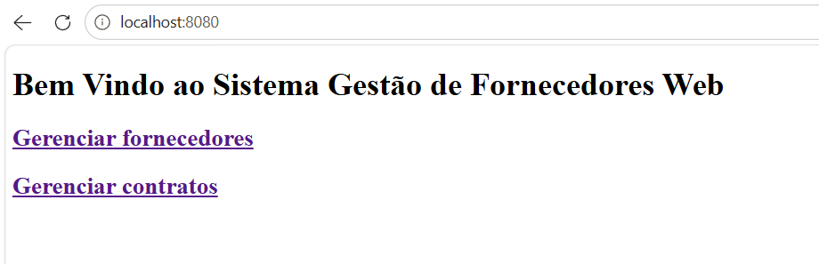
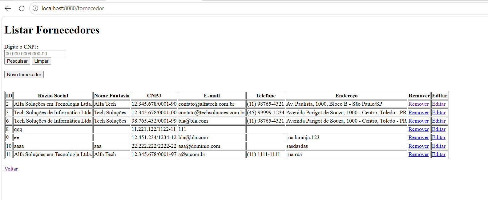
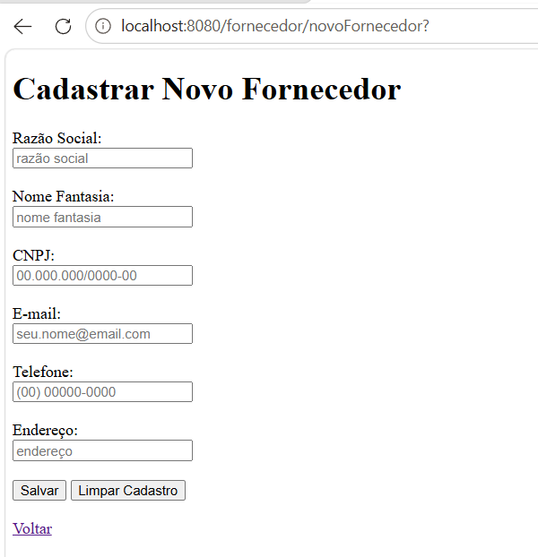
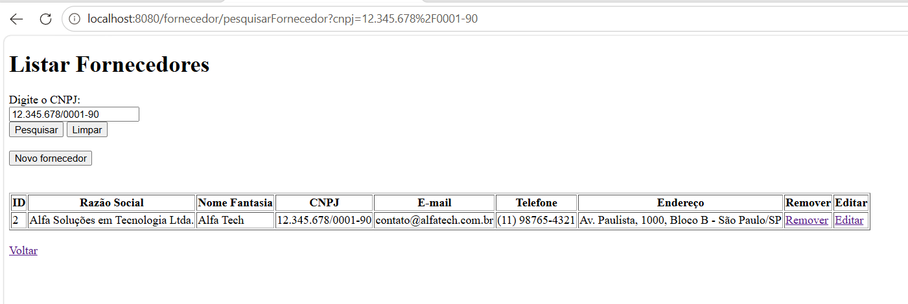
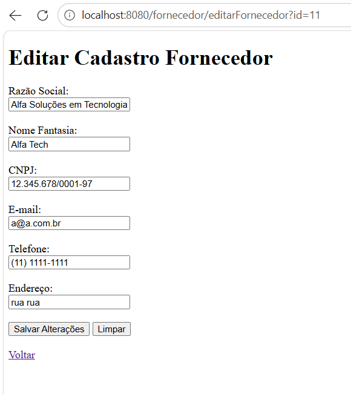
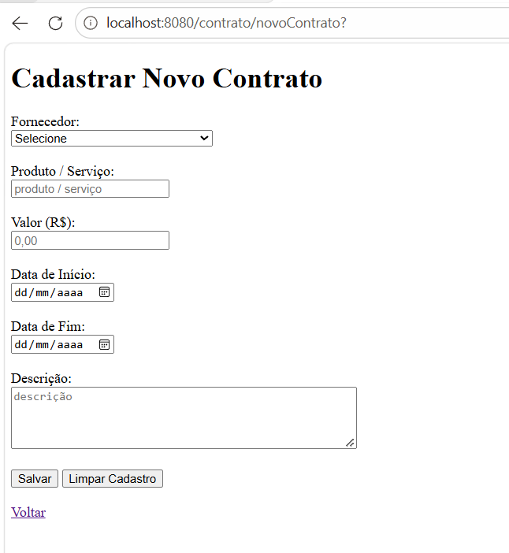
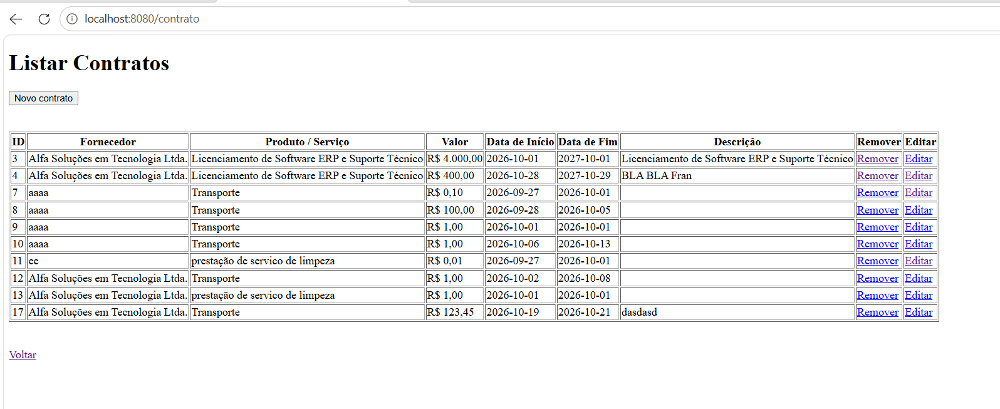
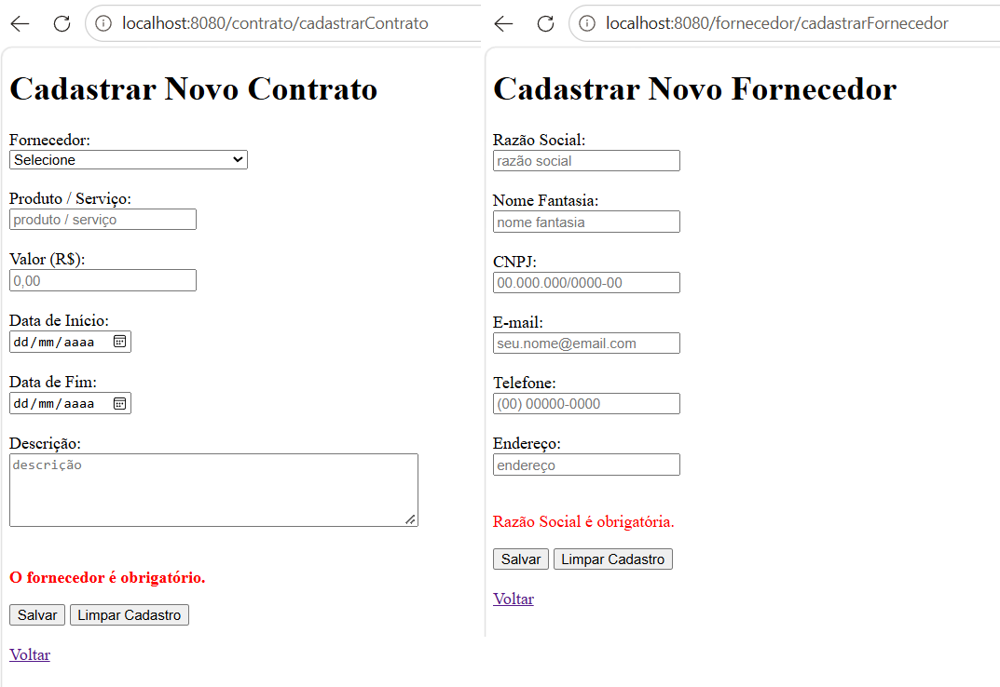
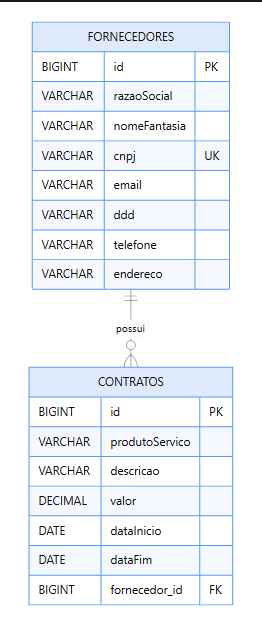

# Gerenciar Fornecedores

Sistema Web para gerenciamento de fornecedores e contratos, desenvolvido como projeto de avaliação da disciplina **Desenvolvimento Web Back End 2**.

O sistema tem como objetivo facilitar o cadastro, a consulta e a manutenção de fornecedores, além do gerenciamento dos contratos associados, incluindo produtos ou serviços negociados, valores e períodos de vigência.

---

## 📌 Sumário

- [Sobre o projeto](#-sobre-o-projeto)
- [Tecnologias utilizadas](#-tecnologias-utilizadas)
- [Arquitetura da aplicação](#-arquitetura-da-aplicação)
- [Funcionalidades](#-funcionalidades)
- [Principais telas](#-principais-telas)
- [Modelagem do banco de dados](#-modelagem-do-banco-de-dados)
- [Estrutura do projeto](#-estrutura-do-projeto)
- [Como executar](#-como-executar)
- [Demonstração para o exame](#-demonstração-para-o-exame)
- [Melhorias e evolução](#-melhorias-e-evolução)

---

## 🎯 Sobre o projeto

A aplicação foi proposta para atender à necessidade de uma empresa que deseja gerenciar seus fornecedores de maneira organizada, mantendo seus dados cadastrais e os contratos firmados.

O sistema contempla operações de cadastro, consulta, atualização e exclusão, além da pesquisa de fornecedores pelo CNPJ.

O projeto também permite estudar conceitos fundamentais de desenvolvimento Web Back End, como arquitetura MVC, separação em camadas, persistência de dados, mapeamento objeto-relacional e implementação de regras de negócio.

## 🛠️ Tecnologias utilizadas

| Tecnologia | Finalidade |
|---|---|
| Java | Linguagem de programação |
| Spring Boot | Configuração e inicialização da aplicação |
| Spring Web / Spring MVC | Tratamento das requisições HTTP |
| Spring Data JPA | Abstração das operações de persistência |
| Hibernate | Implementação ORM, quando configurada como provedora JPA |
| Thymeleaf | Renderização de páginas HTML no servidor |
| Maven | Gerenciamento de dependências e build |
| Banco de dados relacional | Persistência de fornecedores e contratos |

**Observação:** confirme a versão do Java e o banco de dados efetivamente configurados no projeto antes de publicar esta seção como documentação definitiva.

## 🏗️ Arquitetura da aplicação

A aplicação utiliza uma organização em camadas, combinando o padrão MVC com serviços de negócio e repositórios de persistência.

```text
┌──────────────────────────────────────┐
│            Apresentação              │
│       HTML + Thymeleaf               │
└──────────────────┬───────────────────┘
                   │ HTTP
┌──────────────────▼───────────────────┐
│             Controller               │
│   FornecedorController               │
│   ContratoController                 │
└──────────────────┬───────────────────┘
                   │
┌──────────────────▼───────────────────┐
│               Service                │
│    FornecedorService                 │
│    ContratoService                   │
│                                      │
│         Regras de negócio            │
└──────────────────┬───────────────────┘
                   │
┌──────────────────▼───────────────────┐
│             Repository               │
│    FornecedorRepository              │
│    ContratoRepository                │
└──────────────────┬───────────────────┘
                   │ JPA / Hibernate
┌──────────────────▼───────────────────┐
│          Banco de dados              │
│       Fornecedores e contratos       │
└──────────────────────────────────────┘
```

### Responsabilidades das camadas

- **Controller:** recebe requisições HTTP, encaminha os dados e determina a resposta Web.
- **Service:** concentra validações e regras de negócio.
- **Repository:** abstrai consultas e operações de persistência.
- **Model:** representa as entidades e os relacionamentos do domínio.
- **DTO:** representa os dados recebidos dos formulários.
- **View:** apresenta os dados por meio dos templates Thymeleaf.

📷 **Imagem recomendada:** `docs/images/arquitetura.png`

Uma imagem da arquitetura facilita a explicação do fluxo de uma requisição durante a apresentação oral.

## ✅ Funcionalidades

### Fornecedores

- Cadastro de fornecedores.
- Listagem dos registros cadastrados.
- Consulta por CNPJ.
- Atualização dos dados cadastrais.
- Exclusão com verificação de contratos associados.
- Validação de campos e verificação de duplicidade de CNPJ.

### Contratos

- Cadastro de contratos associados a fornecedores.
- Registro do produto ou serviço negociado.
- Registro do valor e das datas de vigência.
- Listagem de contratos e respectivos fornecedores.
- Atualização e exclusão de contratos.
- Verificação de regras relacionadas ao valor, às datas e à vigência.

A disponibilidade e o comportamento efetivo de cada funcionalidade devem ser confirmados na execução da aplicação.

## 🖥️ Principais telas

As imagens desta seção devem ser capturadas diretamente da aplicação em execução. Utilize dados fictícios e evite expor credenciais ou informações reais de fornecedores.

### 1. Página inicial

Tela de entrada para apresentar o sistema e suas opções de navegação.



**Arquivo:** `docs/images/01-pagina-inicial.png`

### 2. Listagem de fornecedores

Apresenta os fornecedores cadastrados e permite demonstrar a consulta dos registros.



**Arquivo:** `docs/images/02-listagem-fornecedores.png`

### 3. Cadastro de fornecedor

Formulário utilizado para inserir os dados cadastrais do fornecedor.



**Arquivo:** `docs/images/03-cadastro-fornecedor.png`

### 4. Pesquisa por CNPJ

Demonstra a funcionalidade de localização de um fornecedor pelo CNPJ.



**Arquivo:** `docs/images/04-pesquisa-cnpj.png`

### 5. Edição de fornecedor

Apresenta a alteração de dados de um fornecedor já cadastrado.



**Arquivo:** `docs/images/05-edicao-fornecedor.png`

### 6. Cadastro de contrato

Formulário para registrar o produto ou serviço, o valor e o período contratual, vinculando o contrato ao fornecedor.



**Arquivo:** `docs/images/06-cadastro-contrato.png`

### 7. Listagem de contratos

Permite demonstrar os contratos cadastrados e a associação com os fornecedores.



**Arquivo:** `docs/images/07-listagem-contratos.png`

### 8. Validações e mensagens

Registre uma captura de uma validação real, como a tentativa de cadastrar um CNPJ duplicado ou um contrato com valor inválido.



**Arquivo:** `docs/images/08-validacoes.png`

> As imagens são referências de documentação: substitua os arquivos pelos screenshots reais do sistema. Se uma tela ou comportamento não estiver implementado, não publique uma imagem ilustrativa como se fosse uma evidência real.

## 🗄️ Modelagem do banco de dados

O modelo possui duas entidades centrais:

- **Fornecedor:** representa os dados cadastrais da empresa.
- **Contrato:** representa os contratos firmados com os fornecedores.

O relacionamento principal é de um para muitos: um fornecedor pode possuir vários contratos, e cada contrato está associado a um fornecedor.

### Diagrama entidade-relacionamento



**Arquivo:** `docs/images/09-modelo-er.png`

O diagrama deve representar as entidades, os principais atributos, as chaves primárias, a chave estrangeira e a cardinalidade do relacionamento.

No código Java, esse relacionamento é representado pelas anotações JPA `@OneToMany`, `@ManyToOne` e `@JoinColumn`.

## 📁 Estrutura do projeto

Estrutura lógica esperada com base nos componentes identificados:

```text
gerenciar-fornecedores/
├── src/
│   ├── main/
│   │   ├── java/
│   │   │   └── .../
│   │   │       ├── controller/
│   │   │       ├── service/
│   │   │       ├── repository/
│   │   │       ├── model/
│   │   │       ├── dto/
│   │   │       └── GerenciarFornecedoresApplication.java
│   │   └── resources/
│   │       ├── templates/
│   │       ├── static/
│   │       └── application.properties
│   └── test/
├── docs/
│   └── images/
├── pom.xml
└── README.md
```

Os nomes e a disposição exatos dos diretórios devem corresponder à estrutura real do repositório.

## 🚀 Como executar

### Pré-requisitos

- JDK compatível com a versão configurada no Maven.
- Maven ou Maven Wrapper.
- Banco de dados configurado, quando necessário.

### Passos

1. Clone o repositório:

```bash
git clone URL_DO_REPOSITORIO
```

2. Acesse a pasta do projeto:

```bash
cd gerenciar-fornecedores
```

3. Configure a conexão com o banco em `src/main/resources/application.properties`.

4. Compile e execute os testes:

```bash
./mvnw clean verify
```

No Windows, se o Maven Wrapper estiver disponível:

```powershell
.\mvnw.cmd clean verify
```

5. Inicie a aplicação:

```powershell
.\mvnw.cmd spring-boot:run
```

6. Acesse o endereço local configurado pela aplicação, normalmente `http://localhost:8080`, caso nenhuma porta diferente tenha sido definida.

> Os comandos pressupõem que o projeto contém Maven Wrapper. Caso não contenha, utilize o Maven instalado e confirme os requisitos de execução no `pom.xml`.

## 🎓 Demonstração para o exame

A apresentação pode seguir esta sequência:

1. Apresentar a página inicial e o objetivo do sistema.
2. Mostrar a estrutura do projeto e as dependências no `pom.xml`.
3. Explicar o fluxo entre Controller, Service, Repository e banco.
4. Apresentar as entidades Fornecedor e Contrato e seu relacionamento.
5. Demonstrar o cadastro e a listagem de fornecedores.
6. Demonstrar a pesquisa por CNPJ.
7. Cadastrar um contrato e mostrar sua associação ao fornecedor.
8. Demonstrar a atualização e as regras de exclusão.
9. Explicar as validações, as limitações encontradas e as melhorias propostas.

### Atalhos para a apresentação

| Assunto | Arquivo ou imagem |
|---|---|
| Arquitetura MVC | `docs/images/arquitetura.png` |
| Estrutura do projeto | `pom.xml` e pacotes Java |
| Cadastro e consulta | `FornecedorController.java` |
| Regras de negócio | `FornecedorService.java` |
| Persistência | `FornecedorRepository.java` |
| Relacionamento entre entidades | `Fornecedor.java` e `Contrato.java` |
| Banco de dados | `docs/images/09-modelo-er.png` |
| Interface Web | `docs/images/02-listagem-fornecedores.png` |
| Contratos | `docs/images/07-listagem-contratos.png` |

## 🔧 Melhorias e evolução

Entre as melhorias que podem ser avaliadas estão:

- Ampliar os testes automatizados de serviços, controllers e persistência.
- Fortalecer a validação do CNPJ.
- Padronizar o tratamento de exceções.
- Utilizar métodos HTTP apropriados para operações de exclusão.
- Revisar a configuração de segurança e o tratamento de dados sensíveis.
- Avaliar a exibição dos contratos associados diretamente à listagem de fornecedores.
- Aprimorar a documentação do banco de dados e dos requisitos funcionais.

Essas melhorias devem ser tratadas conforme as necessidades e as limitações efetivamente verificadas na implementação.

---

## 👩‍💻 Contexto acadêmico

Projeto desenvolvido para o exame de suficiência da disciplina **Desenvolvimento Web Back End 2**, com foco em arquitetura MVC, persistência de dados, gerenciamento de fornecedores e contratos e boas práticas de desenvolvimento Web.

